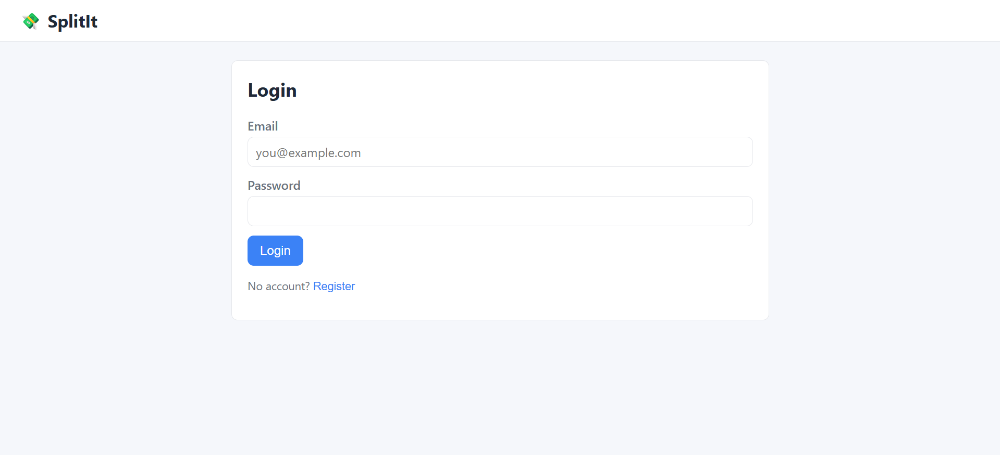
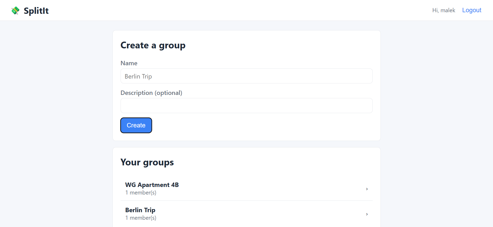
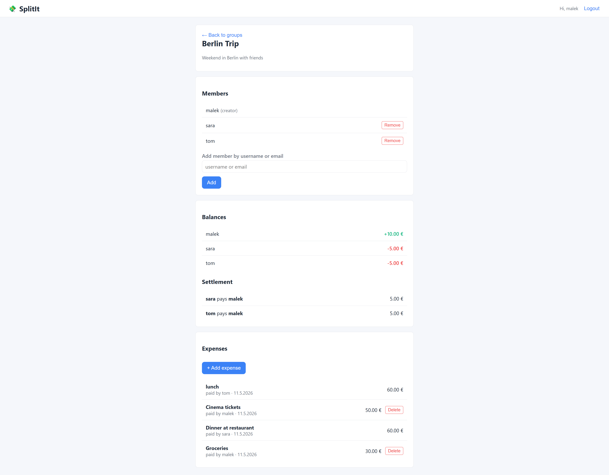
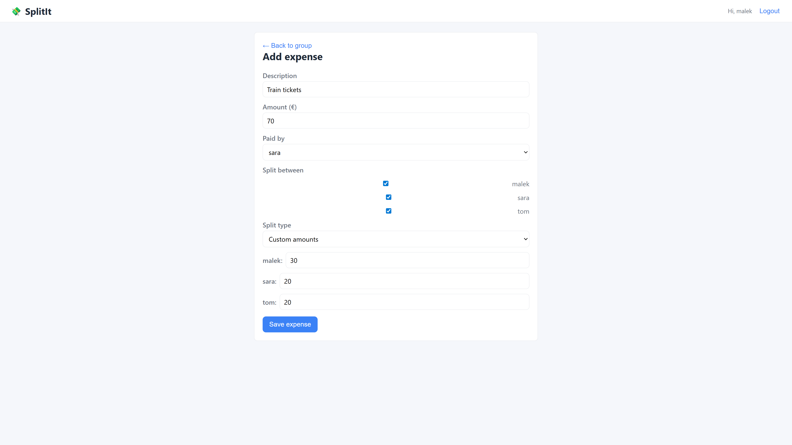

# SplitIt — Shared Expense Tracker

A full-stack web application for tracking shared expenses between friends, roommates, or trip groups. Inspired by Splitwise. Built as a learning project to discover JavaScript, Node.js, Express, and PostgreSQL.

## ✨ Features

- 🔐 **JWT authentication** with bcrypt-hashed passwords
- 👥 **Groups** with multiple members and role-based authorization
- 💸 **Expenses** with equal or custom splits
- ⚖️ **Automatic balance calculation** (who owes whom)
- 🧮 **Debt simplification algorithm** — minimum number of transfers to settle up
- 🌐 **Vanilla JS frontend** talking to a REST API (no framework)
- ⚛️ **Separate React preview** powered by Vite (authentication, groups, members, expenses, and balances migrated)

## 📸 Screenshots

### Login & Registration


### Groups overview
Once logged in, users see all the groups they belong to.


### Group details — balances & settlement
The app calculates each member's net balance and proposes the minimum number of transfers to settle the debts.


### Adding an expense
Supports equal splits or custom amounts per participant. Validation ensures the split sums match the total.


## 🛠️ Tech Stack

**Backend:** Node.js · Express · PostgreSQL (`pg` driver) · JWT · bcrypt
**Frontend:** HTML · CSS · Vanilla JavaScript (`fetch` API, hash routing); separate React + Vite preview
**Dev tools:** nodemon · dotenv · REST Client · Live Server · Vite

## 📁 Project Structure

```
splitit/
├── backend/                # Node.js + Express API
│   ├── src/
│   │   ├── config/         # DB connection
│   │   ├── controllers/    # Route handlers
│   │   ├── services/       # Business logic (balance algorithm)
│   │   ├── middleware/     # JWT auth
│   │   ├── routes/         # API endpoints
│   │   └── server.js       # Entry point
│   ├── sql/                # Database schema
│   └── requests.http       # REST Client test file
├── frontend/               # Vanilla JS SPA and separate React preview
│   ├── index.html           # Existing Vanilla JS entry
│   ├── react.html           # React entry
│   ├── src/                 # React entry and shared API helpers
│   ├── vite.config.js       # Dev proxy: /api -> Express on port 3000
│   ├── css/
│   └── js/
└── docs/screenshots/       # README assets
```

## 🚀 Getting Started

### Prerequisites
- Node.js v20.19+ or v22.12+ (required by Vite 8)
- PostgreSQL 14+

### Setup

```bash
git clone https://github.com/MalekBouaziz2004/splitit.git
cd splitit/backend
npm install
```

Create the database (e.g., via pgAdmin):
```sql
CREATE DATABASE splitit_db;
```

Then run the schema in `sql/schema.sql` against `splitit_db`.

Copy `.env.example` to `.env` and fill in your credentials:
```env
DB_PASSWORD=your_password
JWT_SECRET=any_long_random_string
```

Start the server:
```bash
npm run dev
```

### Run the existing Vanilla JS frontend

Keep the Express server running on `http://localhost:3000`. In a separate terminal, serve `frontend/index.html` with VS Code's **Live Server** extension. Open the URL shown by Live Server (commonly `http://127.0.0.1:5500/frontend/index.html` or `http://127.0.0.1:5500/index.html`, depending on the Live Server root). This remains the functional frontend.

### Run the separate React preview

Keep the same Express server running. In another terminal:

```bash
cd frontend
npm install
npm run dev
```

Open `http://localhost:5173/react.html#login` or `http://localhost:5173/react.html#register` (or use the port printed by Vite). Login and registration use the existing Express API. After either succeeds, `#groups` shows the groups overview, where groups can be listed and created. Selecting a group opens `#group/:id` with group details, member management, expenses, balances, and suggested settlement transfers. Equal and custom expense splits are supported. Settlement transfers are suggestions only; the API does not record payments. Vite forwards `/api` requests to `http://localhost:3000`, so the React API client uses the existing Express routes without a hard-coded API origin. The preview uses the existing `frontend/css/style.css`.

To check the React production bundle, run `npm run build` in `frontend/`. The build writes `frontend/dist/react.html` and its assets; the existing `index.html` is not part of this React build.

## 📡 API Endpoints

| Method | Endpoint                                          | Description                | Auth |
|--------|---------------------------------------------------|----------------------------|------|
| POST   | `/api/auth/register`                              | Register a new user        | —    |
| POST   | `/api/auth/login`                                 | Login and receive JWT      | —    |
| GET    | `/api/auth/me`                                    | Current user profile       | ✅   |
| POST   | `/api/groups`                                     | Create a group             | ✅   |
| GET    | `/api/groups`                                     | List my groups             | ✅   |
| GET    | `/api/groups/:id`                                 | Group details + members    | ✅   |
| POST   | `/api/groups/:id/members`                         | Add a member               | ✅   |
| DELETE | `/api/groups/:id/members/:userId`                 | Remove a member            | ✅   |
| POST   | `/api/groups/:id/expenses`                        | Add an expense             | ✅   |
| GET    | `/api/groups/:id/expenses`                        | List expenses              | ✅   |
| DELETE | `/api/groups/:id/expenses/:expenseId`             | Delete an expense          | ✅   |
| GET    | `/api/groups/:id/balances`                        | Balances + settlement plan | ✅   |

## 🧠 What I Learned

This was my first JavaScript project, built phase by phase as a learning exercise:

- **Phase 1** — Node.js project setup, Express, PostgreSQL connection pooling, environment variables
- **Phase 2** — JWT authentication, bcrypt password hashing, middleware
- **Phase 3** — REST API design, many-to-many relationships, SQL JOINs, authentication vs authorization
- **Phase 4** — Money handling with `NUMERIC`, SQL transactions, service-layer pattern, greedy debt-simplification algorithm
- **Phase 5** — DOM manipulation, `fetch` API, hash-based SPA routing, XSS prevention

## 👤 Author

**Malek Bouaziz** — 4th-semester Computer Science student
[GitHub](https://github.com/MalekBouaziz2004)
